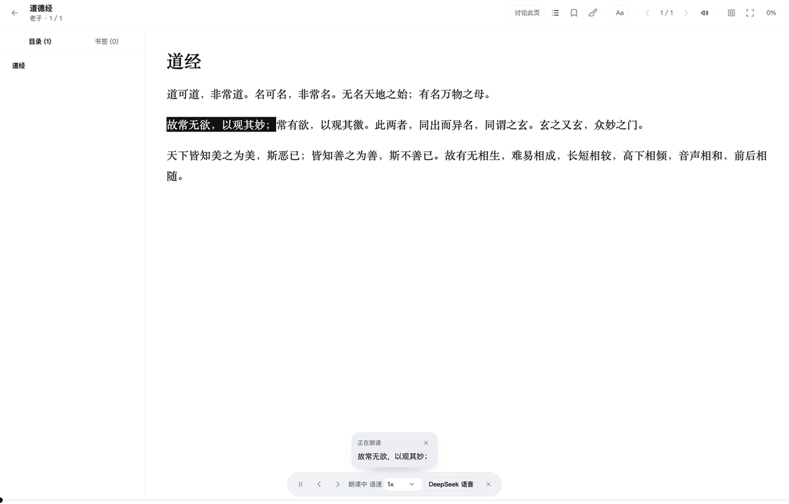
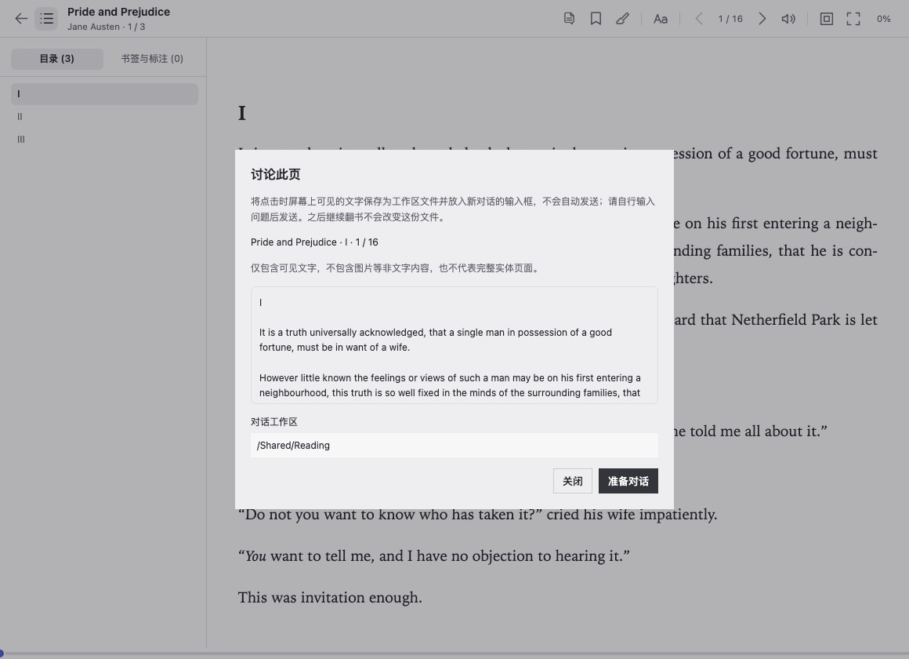

# dsh-bookshelf

A local PDF and EPUB bookshelf and reader for the [DeepSeek Harness](https://github.com/deepseek-ai/deepseek-harness) Web GUI. It integrates reading, annotations, speech synthesis, and page-level AI discussions into a native sidebar workspace.

DeepSeek Harness Web GUI 的本地 PDF / EPUB 书架与阅读器，将阅读、标注、语音合成与页面级 AI 讨论整合在原生的侧栏工作区中。

[](LICENSE)


## Overview / 概览

- **Speech Synthesis & Audiobooks**: Live read-aloud with sentence highlighting and auto-pagination, plus background whole-book rendering with upfront DeepSeek cost estimates.
  **语音朗读与整书合成**：支持逐句高亮与自动翻页的实时朗读，以及带 DeepSeek 费用预估的后台整书音频生成。
- **Page-Level AI Discussion**: Snapshot visible page text into any workspace to start a native DSH conversation with an `@file` reference.
  **页面级 AI 讨论**：将当前可见页面快照保存至工作区，并附带 `@file` 引用直接发起原生对话。
- **Non-Destructive Library**: Import files, link local folders, or link macOS Apple Books libraries without altering original files.
  **无损书库管理**：支持文件导入、文件夹链接及 macOS Apple Books 书库链接，绝不修改原始文件。
- **Native Reading Experience**: Adapts to DSH light, dark, and custom themes with paginated EPUBs and single-page or continuous PDF views, TOC, bookmarks, and per-book highlight/underline styles.
  **原生阅读体验**：自适应 DSH 浅色、深色与自定义主题，提供 EPUB 分页、PDF 单页与连续视图、目录、书签及按书记忆的高亮与下划线样式。

## Screenshots / 截图

| | |
|---|---|
| [](docs/GALLERY.md) | [](docs/GALLERY.md) |
| [](docs/GALLERY.md) | [](docs/GALLERY.md) |

See [docs/GALLERY.md](docs/GALLERY.md) for all views and [docs/DEMO.md](docs/DEMO.md) for the 60-second walkthrough script.

更多视图见 [docs/GALLERY.md](docs/GALLERY.md)，60 秒演示脚本见 [docs/DEMO.md](docs/DEMO.md)。

## Install / 安装

Requires DSH `>=0.2.0-rc.2 <0.3.0` and Node `^22.19.0 || >=24.0.0` on macOS or Windows.

需要 DSH `>=0.2.0-rc.2 <0.3.0` 与 Node `^22.19.0 || >=24.0.0`，支持 macOS 与 Windows。

```sh
dsh plugin --profile web add github:Chriszzx/dsh-bookshelf
dsh plugin --profile web add /absolute/path/to/dsh-bookshelf   # local checkout
```

Registers `ui-bookshelf` in the sidebar and follows the DSH locale (Simplified Chinese / English).

在侧栏注册 `ui-bookshelf`，界面语言自动跟随 DSH（简体中文 / 英文）。

## Core Capabilities / 核心功能

**Shelf & Organization.** Import via file picker, drag-and-drop, or folder links. Manage titles with search, sorting, custom tags, and reading statuses (`Unread`, `Reading`, `Finished`), switching freely between a responsive cover grid and list view.

**书架与整理。** 支持文件选择、拖拽或文件夹链接导入。提供搜索、排序、自定义标签与阅读状态（未读 / 正在阅读 / 已读完），可在响应式封面网格与列表视图间自由切换。

**Reader & Annotations.** EPUBs open in paginated single-page or adaptive spreads with a table of contents. EPUB typography follows the publication, including its embedded regular, bold and italic fonts. Choose a reading font or switch back to the publisher’s font in reading settings. PDFs support zoom and single-page or continuous views. Both remember bookmarks and reading progress. Select text to copy with citation, read aloud, or apply custom highlights and underlines; all marks merge into a searchable, filterable sidebar.

**阅读与标注。** EPUB 支持单页或自适应跨页阅读和目录跳转，默认采用原书字体与排版层级，支持书中嵌入的常规、粗体和斜体字面，可在阅读设置中更换正文字体或恢复原书字体。PDF 支持缩放、单页和连续视图。两种格式都支持书签与进度恢复。选中文本即可带出处复制、朗读或添加高亮与下划线；所有标注与书签统一汇总在可搜索、可排序的侧栏中。

**Live Read-Aloud.** Floating frosted-glass controls for play/pause, sentence stepping, speed, and voice selection. Supports offline system voices (`say` on macOS, SAPI on Windows), Edge TTS (keyless), DeepSeek TTS, and OpenAI-compatible endpoints, with automatic language matching by default.

**实时朗读。** 底部毛玻璃控制栏提供播放/暂停、上下句切换、语速与音色选择。支持离线系统音色（macOS `say`、Windows SAPI）、Edge 语音（免 Key）、DeepSeek 语音及 OpenAI 兼容接口，默认按书籍语言自动匹配音色。

**Whole-Book Audio.** Render an entire book into a single audio file (`WAV` or `MP3`) in the background via the book's `More` menu. Previews character count, duration, file size, and DeepSeek billing estimates before generation.

**整书语音合成。** 通过书籍「更多」菜单在后台将整书合成为单个音频文件（`WAV` 或 `MP3`）。生成前直观预览字数、预计时长、文件体积及 DeepSeek 计费预估。

**Page Discussion & Apple Books.** `Discuss this page` captures visible text into your target workspace and opens a native DSH chat pre-filled with `@file`. On macOS, `Apple Books` links local EPUB and PDF assets directly into the shelf.

**页面讨论与 Apple Books。** 「讨论此页」将当前可见文本保存至目标工作区，并打开预填 `@file` 的原生对话。在 macOS 上可通过「Apple Books」直接将本地书库中的 EPUB 与 PDF 链接至书架。

## Data & Privacy / 数据与隐私

Since 0.6.4, bookshelf HTTP routes require DSH Connection to admit the caller before any operation. This protects book files, reading state, and configured speech services with DSH's Host/Origin and authentication checks.

从 0.6.4 起，书架的 HTTP 路由在处理请求前统一通过 DSH Connection 准入，使用 DSH 的 Host、Origin 和身份检查保护书籍文件、阅读状态与已配置的语音服务。

All state resides under `$DSH_HOME/bookshelf`: `library.json`, `state.json` (progress, bookmarks, annotations), `tags.json`, `tts.json`, `tts-secrets.json` (mode `0600`, write-only to UI), `tts-cache/` (512 MB LRU), and `tts-scratch/` (10-minute TTL for uncached selections). API keys may also be supplied via `DEEPSEEK_API_KEY` or `BOOKSHELF_TTS_OPENAI_KEY`.

所有数据均保存在 `$DSH_HOME/bookshelf` 下：`library.json`、`state.json`（进度、书签、标注）、`tags.json`、`tts.json`、`tts-secrets.json`（`0600` 权限，前端不回显）、`tts-cache/`（512 MB LRU）及 `tts-scratch/`（选区朗读临时音频，10 分钟过期）。API Key 也可通过环境变量 `DEEPSEEK_API_KEY` 或 `BOOKSHELF_TTS_OPENAI_KEY` 提供。

Reading, annotations, Apple Books indexing, and system voices run completely offline. Cloud TTS providers receive text only when invoked. Deleting a book from the shelf never touches original source files.

阅读、标注、Apple Books 索引与系统音色完全离线运行；云端语音服务仅在调用时接收对应文本。从书架删除书籍绝不会影响原始文件。

## Development / 开发

```sh
node scripts/run-checks.mjs all     # syntax + unit/API + browser regressions
node tests/run-browser.mjs tts-playback
```

Requires Chrome and local React UMD fixtures; automated tests never contact external TTS endpoints. Architecture, protocols, and release checklists are documented in [docs/DEVELOPMENT.md](docs/DEVELOPMENT.md).

测试需 Chrome 与本地 React UMD 依赖，自动化测试不请求外部语音服务。架构细节、协议与发布检查清单见 [docs/DEVELOPMENT.md](docs/DEVELOPMENT.md)。

## License / 许可

MIT.
