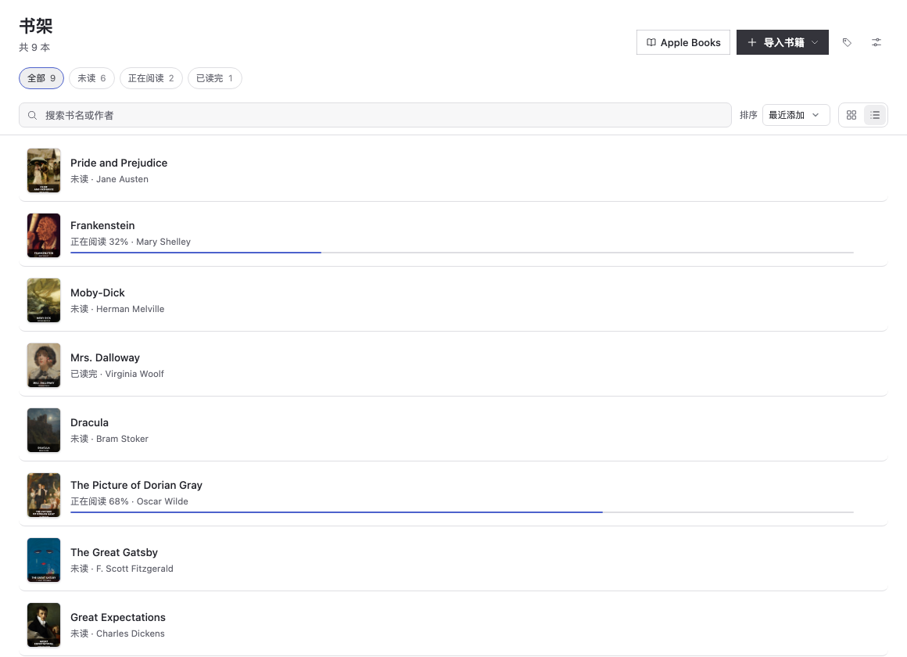
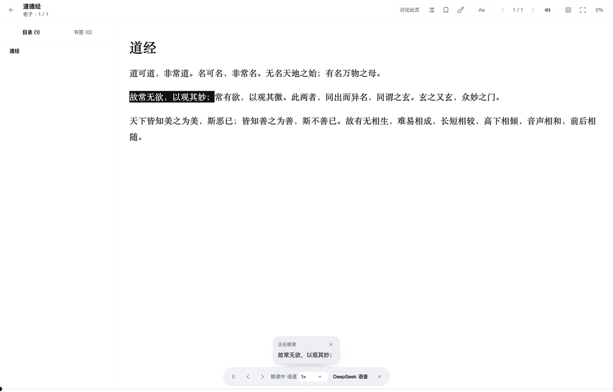
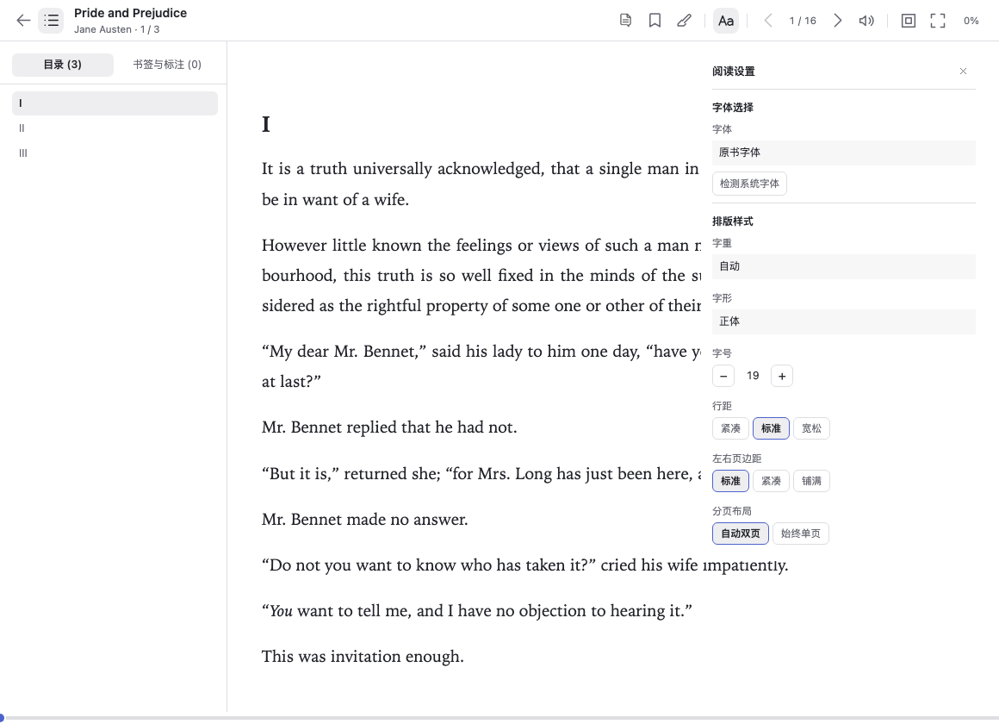

# Screenshots / 截图

Captured with dsh-bookshelf 0.6.4 in an isolated local demo library. The reader shows the first three chapters of *Pride and Prejudice*. The Apple Books picker uses sample catalog records and the audio panels use the macOS system voice option.

截图来自 0.6.4 的独立本地演示书架。阅读器展示《傲慢与偏见》前三章，Apple Books 导入窗口使用示例条目，语音面板选用 macOS 系统音色。

## Shelf / 书架

The cover grid measures its row width first, keeps 20px gutters and picks the largest comfortable column count; a short last row stays left-aligned.

封面网格先测量行宽，固定 20px 间距并选择最合适的列数；最后一行靠左排列。

The list view keeps the same search, sort and status rules, with progress and finished state inline.

列表视图沿用搜索、排序与状态规则，进度和已读完状态显示在行内。

## Read aloud / 逐句朗读

The dock highlights the selected sentence and shows its text, playback controls, speed and active voice.

朗读浮条显示当前句、播放控件、语速与音色。页面上的反色高亮标出同一句正文。

The Read-aloud tab configures the backend, language-aware voice, speed, API fields and disk cache. Secrets are never echoed back.

「朗读」标签页配置后端、按语言匹配的音色、语速、API 字段与磁盘缓存；密钥不会回显。

## Whole-book audio / 整书语音

Review the character and sentence counts, estimated duration and file size before starting. The screenshot shows a local voice. Selecting DeepSeek adds its estimated cost.

开始生成前可查看字数、句数、预计时长和文件体积。图中选用了本机音色，选择 DeepSeek 时还会显示预计费用。

## Page discussion / 页面讨论

Discuss this page snapshots the visible page, shows the captured text and creates a native conversation with an `@file` draft in the chosen workspace.

「讨论此页」会快照当前可见页面、展示捕获的正文，并在所选工作区创建带 `@file` 草稿的原生对话。

## Apple Books import / 导入 Apple Books

On macOS, import EPUB or PDF titles from the local Apple Books library. The shelf links the source instead of moving or changing the original.

在 macOS 上可从本地 Apple Books 书库导入 EPUB 或 PDF；书架以链接方式引用源文件，不会移动或修改原书。

## Reader settings / 阅读设置

In 0.6.4 the EPUB page follows the DSH theme. Open Aa to set the reading font, text size, margins and single-page or adaptive spread layout.

0.6.4 的 EPUB 页面跟随 DSH 主题。在工具栏点「Aa」可调整字体、字号和边距，并选择单页或自适应跨页。

## Demo covers / 演示封面

The covers and the Austen excerpt come from Standard Ebooks. The project publishes its editions and cover artwork for public-domain use in the United States. [Standard Ebooks](https://standardebooks.org/) · [Pride and Prejudice](https://standardebooks.org/ebooks/jane-austen/pride-and-prejudice)

本组封面与《傲慢与偏见》节选取自 Standard Ebooks 的公版版本。[Standard Ebooks 公版说明](https://standardebooks.org/about)
