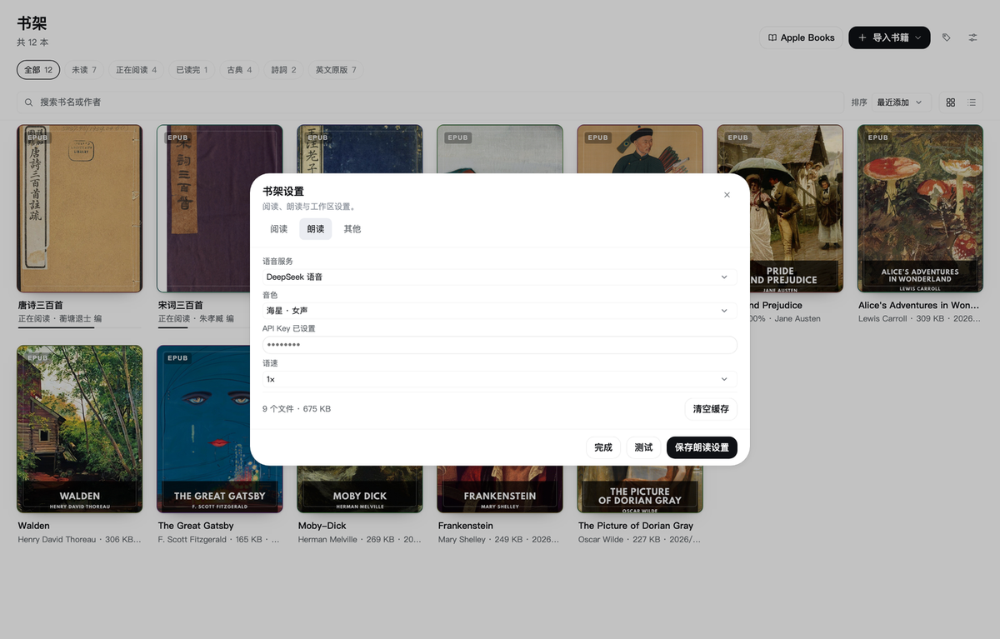
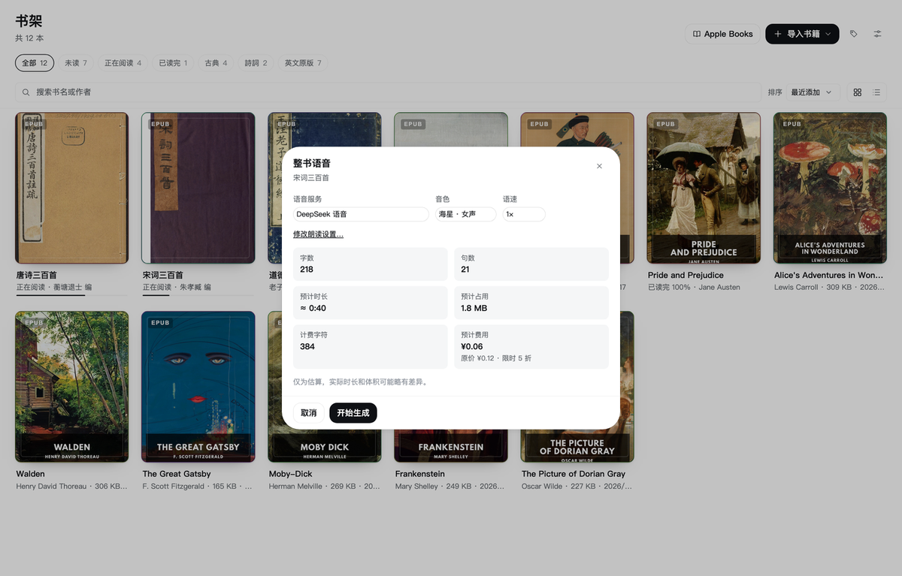
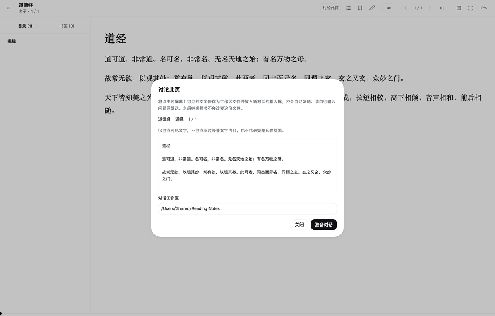
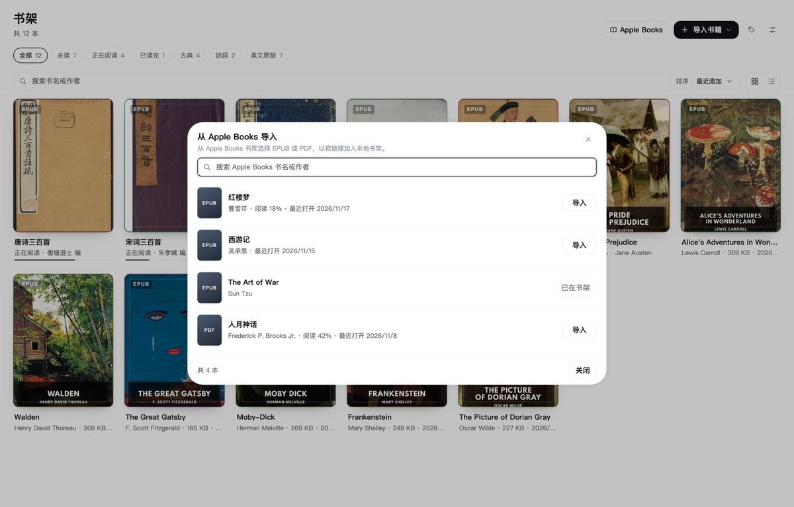
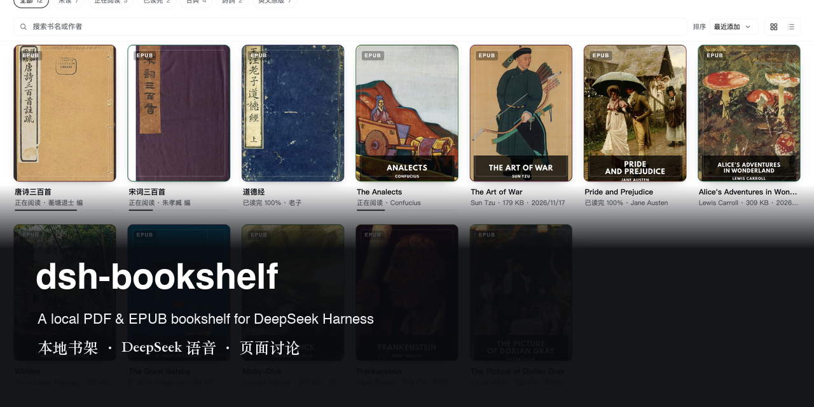

# Screenshots / 截图

These captures use a demo shelf of public-domain titles, a test DeepSeek key and a temporary read-aloud cache. No personal library, account or real API key appears in them.

以下截图使用公版书演示书架、测试用 DeepSeek Key 和临时朗读缓存，不包含个人书库、账号或真实 API Key。

## Shelf / 书架

The cover grid measures its row width first, keeps 20px gutters and picks the largest comfortable column count; a short last row stays left-aligned.

封面网格先测量行宽，固定 20px 间距并选择最合适的列数；最后一行靠左排列。

The list view keeps the same search, sort and status rules, with progress and finished state inline.

列表视图沿用搜索、排序与状态规则，进度和已读完状态显示在行内。

## Read aloud and DeepSeek speech / 朗读与 DeepSeek 语音

Opening the dock selects the current sentence immediately; the spoken sentence is inverted from the page palette, and the dock shows the active DeepSeek voice, speed and status.

打开浮条会立即选中当前句；正在朗读的句子使用页面反色高亮，浮条显示当前 DeepSeek 音色、语速和状态。

The Read-aloud tab configures the backend, language-aware voice, speed, API fields and disk cache. Secrets are never echoed back.

「朗读」标签页配置后端、按语言匹配的音色、语速、API 字段与磁盘缓存；密钥不会回显。

## Whole-book audio / 整书语音

Generate audiobook estimates characters, sentences, duration, size and the DeepSeek bill before rendering the whole book on the Host.

「生成整书语音」会先展示字数、句数、预计时长、体积和 DeepSeek 预估费用，再由 Host 在后台渲染整本书。

## Page discussion / 页面讨论

Discuss this page snapshots the visible page, shows the captured text and creates a native conversation with an `@file` draft in the chosen workspace.

「讨论此页」会快照当前可见页面、展示捕获的正文，并在所选工作区创建带 `@file` 草稿的原生对话。

## Apple Books import / 导入 Apple Books

On macOS, import EPUB or PDF titles from the local Apple Books library. The shelf links the source instead of moving or changing the original.

在 macOS 上可从本地 Apple Books 书库导入 EPUB 或 PDF；书架以链接方式引用源文件，不会移动或修改原书。

## Reader settings / 阅读设置

Typography, margins, page mode and the reading palette follow the DSH theme; pinned Light and Dark use the same DSH palettes.

排版、边距、阅读模式与阅读主题跟随 DSH 主题；固定的浅色/深色也使用 DSH 自己的配色。

## Demo covers / 演示封面

The demo shelf uses real editions. English covers come from [Standard Ebooks](https://standardebooks.org/), whose cover art is in the public domain in the United States. The three Chinese covers are period scans from Wikimedia Commons:

演示书架使用真实书籍封面。英文封面来自 [Standard Ebooks](https://standardebooks.org/)，其封面艺术在美国属于公有领域。三本中文书的封面为 Wikimedia Commons 上的古籍扫描：

| Book | Source | License |
|---|---|---|
| 唐诗三百首 | [Three Hundred Tang Poems (1).jpg](https://commons.wikimedia.org/wiki/File:Three_Hundred_Tang_Poems_%281%29.jpg) | Public domain |
| 道德经 | [DaoDeJingWangBi.jpg](https://commons.wikimedia.org/wiki/File:DaoDeJingWangBi.jpg) | Public domain |
| 宋词三百首 | [稿本宋词三百首封面題簽.png](https://commons.wikimedia.org/wiki/File:%E7%A8%BF%E6%9C%AC%E5%AE%8B%E8%AF%8D%E4%B8%89%E7%99%BE%E9%A6%96%E5%B0%81%E9%9D%A2%E9%A1%8C%E7%AD%BE.png) | CC BY-SA 4.0 (Wikimedia Commons contributor) |

The Chinese scans are historical editions, so their title slips keep the original lettering. The shelf UI and book text shown in the screenshots use Simplified Chinese.

中文封面为古籍扫描，书名签保留原刻字形；截图中的书架界面与正文均为简体中文。

## Social preview / 社交预览

`images/social-preview.png` is sized for GitHub's repository social preview (1280×640); upload it under the repository settings.

`images/social-preview.png` 是 GitHub 仓库社交预览尺寸（1280×640），可在仓库设置中上传。
